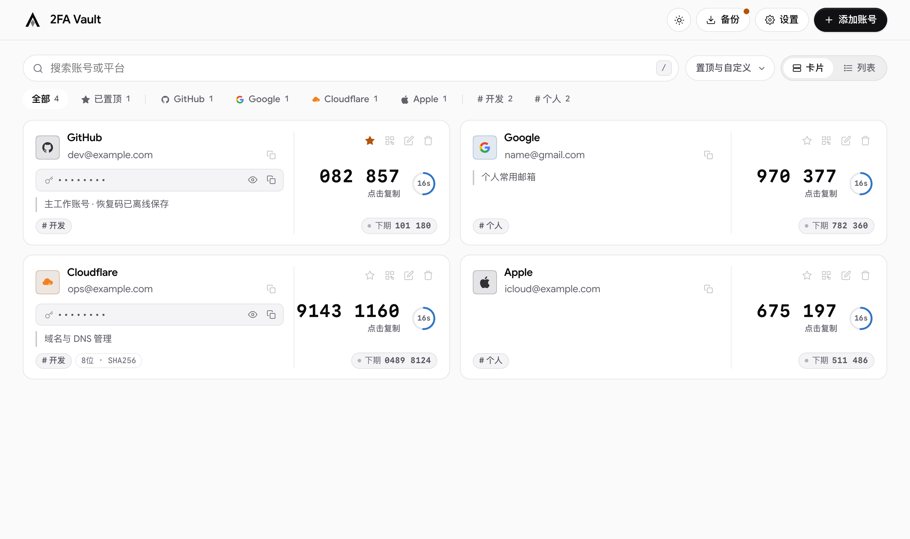
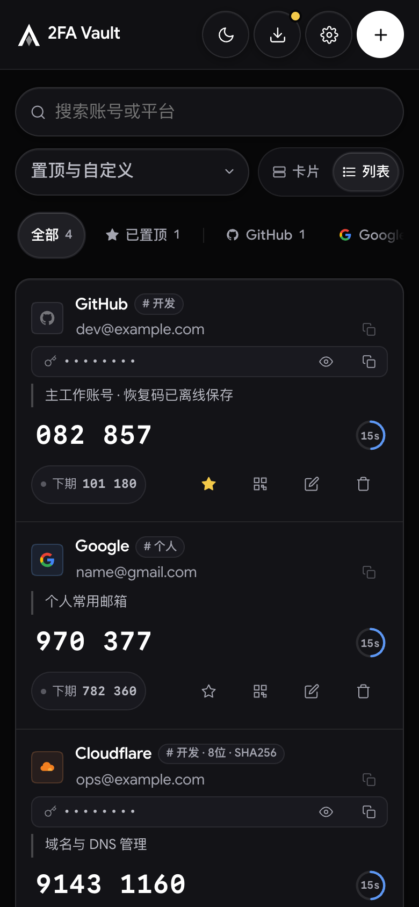

# 2FA Vault

[简体中文](README.md) | **English**

A **single-file, zero-network, completely offline** browser-based 2FA (TOTP) authenticator. Open `2fa-vault.html` directly in any modern browser—no installation, no backend server, and no external CDN requests. All secrets, notes, and optional login passwords stay locally in your browser.

## Preview

| Desktop (Light Mode) | Mobile (Dark Mode) |
| :---: | :---: |
|  |  |

## Key Features

### Offline Security & Reliability
- **Single-File & Zero Network**: Bundles offline QR decoding (`jsQR`), QR generation (`qrcode-generator`), and dual Web Crypto + pure-JS cryptographic engines so everything works offline and over `file://`.
- **Optional Master Password Lock**: Protects secrets, login passwords, and notes in browser local storage using `AES-256-GCM` with `PBKDF2-HMAC-SHA256` (600,000 iterations), supporting inactivity auto-lock and instant manual lock.
- **Local `file://` Storage Isolation Note**: When opened directly as a local file in Chrome or Edge, all local HTML pages share the same `localStorage`, so unencrypted data can be read by other local pages you open. Enabling **Master Password Lock** in **Settings** is strongly recommended once you save real accounts.
- **Data Integrity Safeguards**:
  - Distinguishes read errors, unavailable storage, write failures, and multi-tab write conflicts; preserves original data on errors with raw export and retry options.
  - Confirmation prompt before deleting accounts plus a 10-second Undo bar.
  - Double password confirmation for encrypted backups and pre-import validation preview showing ready, duplicate, and invalid records.

### Fast Import & Daily Workflow
- **Two-Step Smart Import**:
  - Paste delimited credentials such as `account---password---secret` (supports `---`, `|`, `:`, `,`, spaces, tabs, and common labels) to auto-fill service, account, password, and secret in one step.
  - Supports `otpauth://` URIs, raw Base32 keys, Google Authenticator `otpauth-migration://` batch exports, and uploading, dragging, or pasting (`Cmd/Ctrl+V`) QR screenshots.
  - Live TOTP preview with countdown and quick platform presets with automatic icons.
- **Built for Everyday Speed**:
  - Supports **SHA-1 / SHA-256 / SHA-512**, **6-digit / 8-digit** codes, and custom refresh periods; recalculates fresh codes at the exact moment you click copy.
  - Always-visible next-period code (click to copy) and non-shifting amber warning during the final 5 seconds.
  - Press `/` to search, `Enter` to copy the first matching code, and `Esc` to clear; filter by pinned status, platform, or group.
  - Grid & List views, Light / Dark / Auto themes, **bilingual UI (`简体中文` / `English`, auto-detected & switchable in Settings)**, and drag-and-drop / long-press / keyboard (`Alt+↑/↓`) reordering.
  - Optional login password storage with one-click copy and automatic re-masking after 30 seconds or when switching tabs.

## Getting Started

1. Download [`2fa-vault.html`](2fa-vault.html) to a permanent folder on your device.
2. Open it directly in Chrome, Edge, Safari, or Firefox, and bookmark it for daily access.
3. Sample demo accounts appear on first launch—click **Clear Demos** at the top to start adding your own accounts.

> **Important Notes**
> - Accounts are stored in your browser's local storage; `2fa-vault.html` itself contains only application code, not your saved accounts.
> - Before switching devices, changing browsers, or clearing site data, export an encrypted backup (`.2favault.json`) via **Backup** and restore it in the new environment.
> - If you store login passwords alongside 2FA secrets, enabling **Master Password Lock** in **Settings** is strongly recommended.

## License

Released under the [MIT License](LICENSE). Bundled offline libraries retain their respective licenses: `jsQR` (Apache-2.0) and `qrcode-generator` (MIT).
