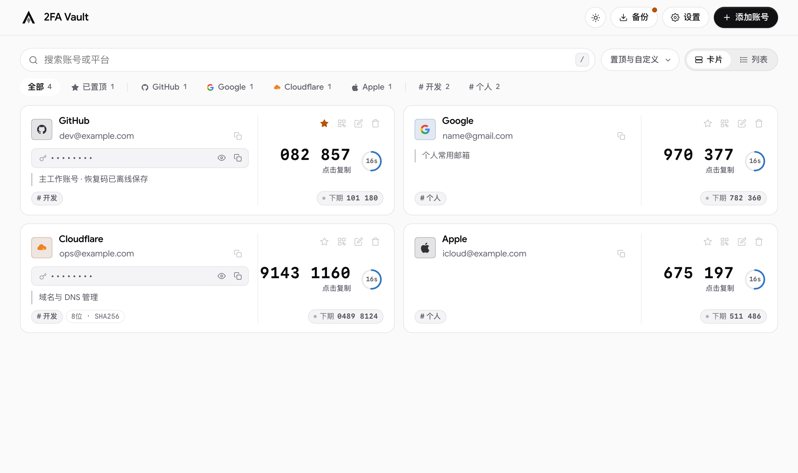
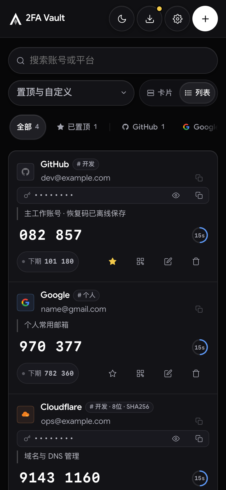

# 2FA Vault

**简体中文** | [English](README.en.md)

一款**单文件、零外部网络请求、完全离线运行**的浏览器端 2FA（TOTP）验证码管理器。双击 `2fa-vault.html` 即可直接使用，无需安装、无需服务端，所有密钥、备注与可选登录密码均保存在本地浏览器中。

## 界面预览

| 桌面端（浅色模式） | 移动端（深色模式） |
| :---: | :---: |
|  |  |

## 核心特性

### 离线安全与加密
- **单文件零外链**：内置二维码解码（`jsQR`）、二维码生成（`qrcode-generator`）以及 Web Crypto + 纯 JS 双引擎，断网环境或直接通过 `file://` 打开均可完整运行。
- **可选主密码锁**：开启后采用 `AES-256-GCM` + `PBKDF2-HMAC-SHA256`（60 万次迭代）对浏览器本地存储中的全部密钥、密码与备注进行密文保存，支持无操作自动锁定与手动即时锁定。
- **数据可靠性保护**：
  - 区分读取失败、存储不可用、写入失败与多标签页冲突，异常时保留原始数据不静默覆盖，提供原样导出与重试入口。
  - 删除账号前二次确认，删除后提供 10 秒撤销栏。
  - 导出加密备份时要求两次确认密码；恢复备份前可预览新增、重复与无效条目。

### 高效导入与管理
- **两步智能添加**：
  - 支持直接粘贴 `账号---密码---密钥`（兼容 `---`、`|`、`:`、`,`、空格、制表符等多种分隔符）一键填入平台、账号、登录密码与密钥。
  - 支持 `otpauth://` 认证链接、纯 Base32 密钥、Google Authenticator `otpauth-migration://` 批量迁移码，以及上传、拖拽或 `Cmd/Ctrl+V` 直接粘贴二维码截图。
  - 第二步提供实时验证码校验与常用平台预设（自动匹配图标）。
- **日常取码体验**：
  - 支持 **SHA-1 / SHA-256 / SHA-512**、**6 位 / 8 位**、自定义刷新周期；点击复制时按当前时刻即时重新计算，避免跨周期复制到旧码。
  - 常显下一周期验证码，点击可直接复制；最后 5 秒以橙色提示而不引起布局跳动。
  - 搜索框支持 `/` 快捷聚焦、回车一键复制首个匹配项验证码、`Esc` 清空；支持按置顶、平台与分组筛选。
  - 支持卡片 / 列表双视图、浅色 / 深色 / 跟随系统主题、**中英双语界面（自动识别浏览器语言，可在设置中即时切换）**，以及鼠标拖拽、触屏长按拖拽与键盘 `Alt+↑/↓` 排序。
  - 可选保存对应账号的登录密码，支持一键复制，展开明文后 30 秒或切至后台标签页自动隐藏。

## 快速开始

1. 下载本仓库中的 [`2fa-vault.html`](2fa-vault.html) 到本地任意固定目录。
2. 用现代浏览器（Chrome / Edge / Safari / Firefox）直接打开该 HTML 文件，建议加入收藏夹方便日常取码。
3. 首次打开会展示示例账号方便体验，点击顶部“清空示例”即可开始添加自己的账号。

> **重要提示**
> - 账号数据保存在当前浏览器的本地存储中，`2fa-vault.html` 文件本身只包含程序代码，不包含你的账号数据。
> - 更换设备、更换浏览器或清理浏览器数据时，请先使用右上角**备份**功能导出加密备份（`.2favault.json`），再到新环境中导入恢复。
> - 如同时保存了登录密码，建议在**设置**中开启主密码锁。

## 开源许可

本项目采用 [MIT License](LICENSE) 开源。内置第三方离线库遵循其各自协议：`jsQR`（Apache-2.0）、`qrcode-generator`（MIT）。
